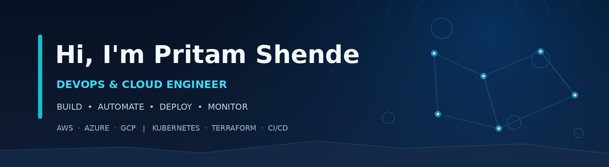

 

## 👨‍💻 About Me

I'm **Pritam Shende**, a **DevOps & Cloud Engineer** who enjoys building secure, scalable infrastructure and making software delivery faster and more reliable through automation.

- ☁️ Working with **AWS, Azure, and Google Cloud**.
- 🚢 Building and operating workloads with **Docker, Kubernetes, and Helm**.
- 🏗️ Automating infrastructure with **Terraform** and CI/CD pipelines.
- 🔐 Interested in **DevSecOps, GitOps, cloud security, and platform engineering**.
- 📈 Monitoring and improving reliability with **Prometheus and Grafana**.
- 🌐 My portfolio is deployed on **Netlify**: **[See it live](https://pritamshende76.netlify.app/)**.

## 🧰 Tech Stack

**Cloud & infrastructure**

**Containers, CI/CD & GitOps**

**Observability, scripting & security**

## 🌟 Featured Work

### [🌐 My 3D DevOps Portfolio](https://pritamshende76.netlify.app/)
A personal website highlighting my experience, skills, and DevOps journey. Built with code managed on GitHub and **deployed using Netlify's free hosting tier**.

> **Coming next:** More public infrastructure-as-code, Kubernetes, and automation projects.

## 📊 GitHub Stats

<!-- These widgets use a public third-party API and might temporarily fail due to rate limits. -->

Note: Language stats are derived mainly from public repository code, so they do not represent all professional experience. Stats cards are served by a third party and may sometimes be unavailable.

## 🤝 Let's Connect

I'm interested in discussing **DevOps, cloud infrastructure, Kubernetes, automation, and platform engineering**.

- 🌐 **Portfolio:** https://pritamshende76.netlify.app/
- 💼 **LinkedIn:** https://www.linkedin.com/in/pritam-shende-85a5a2158/
- 🧑‍💻 **GitHub:** https://github.com/pritamshende

**Build • Automate • Deploy • Monitor • Improve** 🚀

